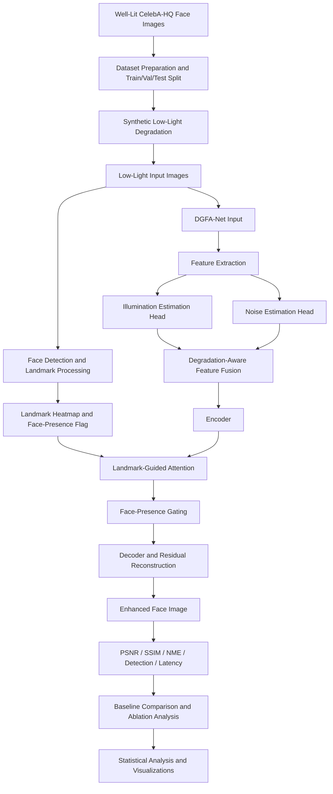
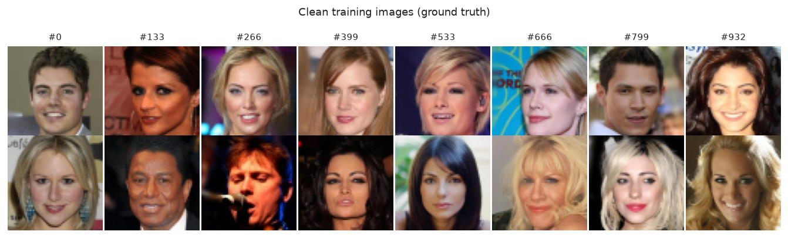
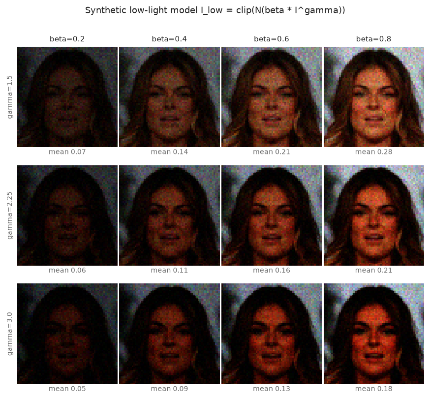
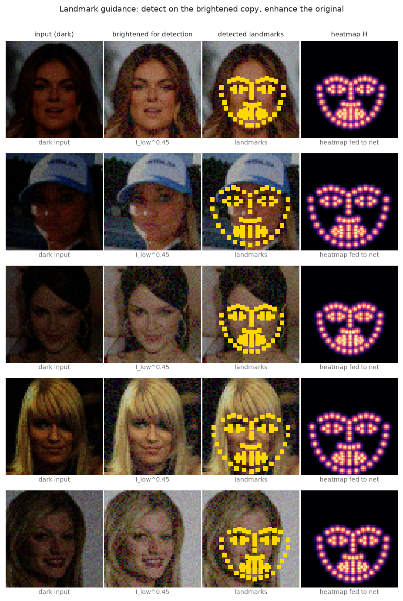
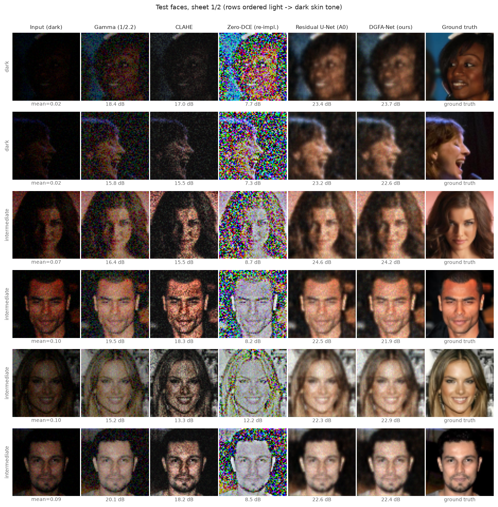
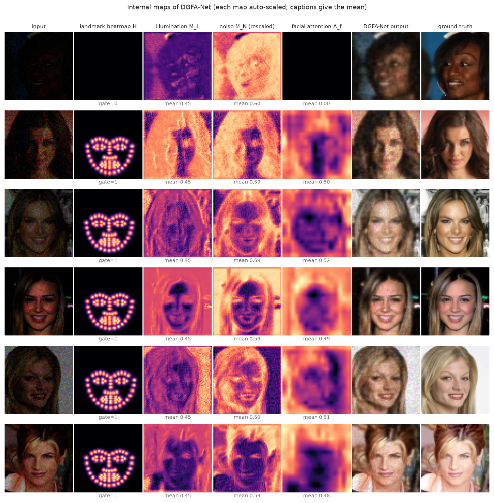
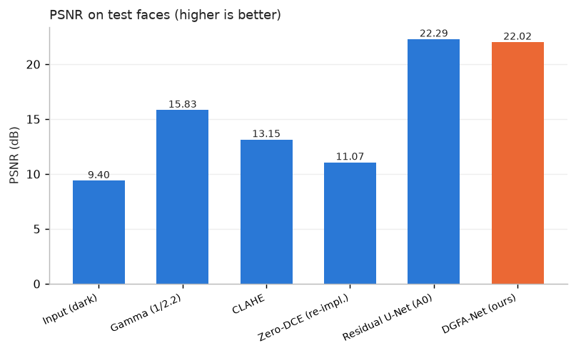
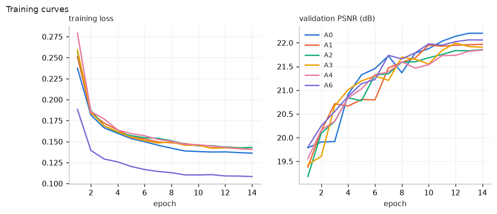

# DGFA-Net: Degradation-Aware, Landmark-Guided Low-Light Face Enhancement

**A Research Implementation and Empirical Evaluation of Low-Light Facial Image Enhancement**

**Institution:** Netaji Subhash University of Technology (NSUT)  
**Academic Year:** 2026-27  
**Authors:** Saloni Singh and Aditya Gayake  
**Supervisor:** Prof. Ankush Jain

---

## 1. Project Overview

Low-light facial images often suffer from poor illumination, reduced contrast, noise, and loss of important facial details. Conventional enhancement techniques can improve overall brightness, but they do not necessarily preserve identity-relevant facial structures.

**DGFA-Net (Degradation-Aware, Landmark-Guided Face Enhancement Network)** investigates whether explicitly estimating image degradation and incorporating facial landmark-guided attention can improve low-light face enhancement.

The proposed architecture combines three central ideas:

1. **Degradation-aware feature learning:** Estimates illumination and noise maps directly from the input image.
2. **Landmark-guided attention:** Uses facial landmark heatmaps to guide feature refinement around important facial regions.
3. **Face-presence gating:** Controls landmark-guided attention based on whether a face is detected.

The repository contains the proposed architecture, classical enhancement methods, learned baselines, ablation experiments, evaluation metrics, visualization utilities, and a reproducible CPU experiment.

### Main Experimental Finding

In the completed experiment, the Residual U-Net baseline (A0) achieved higher PSNR and SSIM than the full DGFA-Net configuration (A3). DGFA-Net achieved slightly lower Normalized Mean Error (NME).

The current experiment therefore does not establish that the proposed components improve overall reconstruction quality. This negative result is retained and reported transparently.

---

## 2. Research at a Glance

| Parameter | Experimental Configuration |
|---|---|
| Dataset | 2,000 real CelebA-HQ photographs |
| Training split | 1,600 images |
| Validation split | 200 images |
| Test split | 200 images |
| Input resolution | 64 × 64 |
| Training duration | 14 epochs per learned model |
| Batch size | 16 |
| Random seed | 0 |
| Hardware | CPU |
| Processor | AMD Ryzen 7 8840U |
| PyTorch | 2.15.0+cpu |
| Landmark backend | OpenCV Haar cascade with approximate box-derived 68-point template |
| Total pipeline runtime | 78 minutes 22 seconds |
| LPIPS | Not computed |

**Experimental qualification:** Low-light inputs were synthetically generated from well-lit CelebA-HQ photographs. This experiment is not a validation on a real paired low-light face dataset.

---

## 3. Research Motivation and Objectives

Low-light image enhancement is challenging because illumination degradation affects different regions of an image differently.

For facial images, enhancement should ideally preserve:

- Eye and eyebrow structures
- Nose and mouth boundaries
- Facial contours
- Local texture and identity-related information
- Overall image contrast and brightness

A model that simply increases brightness may also amplify noise or distort facial details.

### Research Question

Can explicitly modelling low-light degradation and incorporating facial landmark-guided attention improve facial image enhancement compared with a conventional supervised reconstruction network?

### Research Objectives

- Develop a lightweight degradation-aware face enhancement architecture.
- Estimate illumination and noise information directly from the input image.
- Incorporate landmark-guided attention into an encoder-decoder network.
- Introduce a face-presence gate to control the attention mechanism.
- Compare the proposed model against classical and learned enhancement baselines.
- Evaluate the contribution of individual components through controlled ablation experiments.
- Analyse reconstruction quality, structural preservation, detection performance, and inference latency.

---

## 4. Complete Project Pipeline

The following diagram represents the implemented experimental workflow, from dataset preparation to quantitative evaluation.



### Step 1: Dataset Preparation

The experiment uses 2,000 real CelebA-HQ photographs.

The dataset is divided into:

- Training: 1,600 images
- Validation: 200 images
- Testing: 200 images

The same held-out test inputs are used for all compared enhancement methods to support paired comparisons.

### Step 2: Synthetic Low-Light Degradation

Well-lit images are transformed into low-light observations using exposure reduction, gamma transformation, and noise.

The implemented degradation model is:

$$
I_{\mathrm{low}} =
\mathrm{clip}
\left(
\beta I_{\mathrm{gt}}^{\gamma} + N
\right)
$$

Where:

- $I_{\mathrm{gt}}$ represents the original ground-truth image.
- $\beta$ controls exposure intensity.
- $\gamma$ controls nonlinear brightness transformation.
- $N$ represents the added noise.

The experimental parameter ranges are:

$$
\beta \sim U[0.2,0.8]
$$

$$
\gamma \sim U[1.5,3.0]
$$

Noise combines signal-dependent Poisson noise and Gaussian read noise.

### Step 3: Face Detection and Landmark Processing

Face detection and landmark processing provide structural information to the enhancement network.

The implemented experiment uses an OpenCV Haar cascade to detect face bounding boxes. A box-derived approximate 68-point facial template is then used to construct landmark guidance.

These are approximate template-derived landmarks, not individually detected ground-truth facial landmarks.

### Step 4: DGFA-Net Enhancement

The low-light image and its structural guidance are passed through the proposed network.

The network estimates degradation information, extracts image features, applies landmark-guided attention, and reconstructs an enhanced output.

### Step 5: Evaluation

The enhanced images are evaluated using:

- Peak Signal-to-Noise Ratio (PSNR)
- Structural Similarity Index (SSIM)
- Normalized Mean Error (NME)
- Face detection rate
- Inference latency

The results are compared against classical enhancement techniques, learned baselines, and architectural ablations.

---

## 5. Proposed DGFA-Net Architecture

DGFA-Net follows an encoder-decoder design with additional degradation estimation and landmark-guided feature refinement.

### 5.1 Feature Extraction Stem

The input low-light image is first passed through a feature extraction stem.

This stage extracts shallow visual information such as local edges, texture, intensity variations, and basic facial structures.

These features form the foundation for subsequent degradation estimation and reconstruction.

### 5.2 Degradation Estimation Heads

The architecture contains two degradation estimation heads.

**Illumination Estimation Head**

Predicts an illumination map:

$$
M_L = f_L(I_{\mathrm{low}})
$$

The illumination map provides spatial information about brightness variations across the image.

**Noise Estimation Head**

Predicts a noise map:

$$
M_N = f_N(I_{\mathrm{low}})
$$

The noise map provides information about regions that may require noise-aware refinement.

Both maps are estimated from the input rather than directly supplied as degradation parameters.

### 5.3 Degradation-Aware Feature Fusion

The estimated illumination and noise maps are combined with extracted image features.

This allows the network to use degradation-related information during subsequent feature processing.

### 5.4 Encoder-Decoder Network

The fused representation is passed through an encoder-decoder architecture.

- The encoder extracts progressively more abstract feature representations.
- The bottleneck processes high-level information.
- The decoder reconstructs spatial details and predicts the enhancement correction.

### 5.5 Landmark-Guided Attention

A landmark heatmap provides spatial guidance to the attention mechanism.

The attention formulation implemented in the project is:

$$
A_f =
\sigma
\left(
\mathrm{Conv}_{1\times1}([F_3,H])
\right)
\cdot \mathrm{flag}
$$

Where:

- $F_3$ represents the bottleneck feature representation.
- $H$ represents the landmark heatmap.
- $\sigma$ represents the sigmoid activation.
- $\mathrm{flag}$ represents the face-presence indicator.

The guided feature representation is:

$$
F_{\mathrm{guided}} =
F_3(1+\alpha A_f)
$$

This mechanism allows the network to refine features using facial structural guidance.

### 5.6 Face-Presence Gating

Landmark-guided attention should not be relied upon when a face is unavailable.

The face-presence flag controls the attention mechanism, suppressing landmark-guided refinement when a face is not detected.

This is intended to make the architecture more robust to missing face detections.

### 5.7 Residual Reconstruction

Instead of directly predicting the complete enhanced image, the network predicts a residual correction.

$$
I_{\mathrm{enh}} =
\mathrm{clamp}
\left(
I_{\mathrm{low}}+\Delta I
\right)
$$

Where:

- $I_{\mathrm{low}}$ is the original low-light input.
- $\Delta I$ is the predicted enhancement residual.
- $I_{\mathrm{enh}}$ is the final enhanced output.

Residual reconstruction allows the model to learn the correction required to transform the degraded image into its enhanced counterpart.

---

## 6. Training Objective

The implemented training objective combines reconstruction, structural similarity, face-region weighting, and illumination-map smoothness.
The individual terms are:

| Loss | Purpose |
|---|---|
| $\mathcal{L}_1$ | Pixel-level reconstruction accuracy |
| $\mathcal{L}_{\mathrm{SSIM}}$ | Structural similarity preservation |
| $\mathcal{L}_{\mathrm{face}}$ | Additional emphasis on facial regions |
| $\mathcal{L}_{\mathrm{TV}}$ | Smoothness regularization for illumination estimation |

### Optimization

The model is trained using:

- Adam optimizer
- Initial learning rate of $2\times10^{-4}$
- Cosine learning rate decay
- Gradient clipping
- Best-validation checkpoint selection

---

## 7. Baselines and Related Research

A meaningful enhancement model must be compared against both conventional image processing techniques and learned neural network approaches.

### 7.1 Classical Baselines

| Method | Description |
|---|---|
| Input (Dark) | Original low-light image without enhancement |
| Gamma Correction | Nonlinear intensity transformation for brightness correction |
| CLAHE | Contrast Limited Adaptive Histogram Equalization for local contrast enhancement |

These methods provide reference points for evaluating whether a learned model offers improvements over conventional image enhancement.

### 7.2 Learned Baselines

**Zero-DCE**

Zero-Reference Deep Curve Estimation is a deep learning approach for low-light image enhancement that learns image-specific enhancement curves without requiring paired normal-light reference images during training.

The project includes a re-implementation of Zero-DCE as a learned baseline. It is not the original authors' released checkpoint.

**Residual U-Net (A0)**

A supervised encoder-decoder baseline that predicts an image enhancement residual.

It serves as the main architectural comparison for determining whether the additional degradation estimation and landmark-guided attention mechanisms contribute to reconstruction quality.

The encoder-decoder design is related to the U-Net family of architectures.

**DGFA-Net (A3)**

The full proposed configuration, incorporating:

- Illumination and noise estimation heads
- Landmark-guided attention
- Face-presence gating
- Residual reconstruction

### 7.3 Additional Relevant Research

**Retinex-Net**

RetinexNet uses Retinex theory to decompose an image into illumination and reflectance components, enabling low-light enhancement through illumination adjustment and reflectance processing.

Retinex-Net is discussed as relevant related research but is not bundled as a trained baseline in this experiment.

---

## 8. Ablation Study

Ablation experiments are used to investigate the contribution of individual architectural components.

| Variant | Configuration |
|---|---|
| A0 | Residual U-Net baseline |
| A1 | A0 + illumination and noise degradation heads |
| A2 | A1 + landmark attention, without presence gate |
| A3 | A1 + landmark attention + presence gate |
| A4 | A3 with fixed $\alpha=0.5$ |
| A5 | A3 weights, but landmarks detected on the raw dark input |
| A6 | A3 trained without face-weighted loss |

The following variants completed in the verified run:

A0, A1, A2, A3, A4, A6 and Zero-DCE.

A5 was evaluated at inference time using A3 weights.

### Ablation Results

| Variant | Description | PSNR | SSIM | NME | Detection |
|---|---|---:|---:|---:|---:|
| A0 | Residual U-Net | 22.29 | 0.798 | 0.026 | 96% |
| A1 | + Degradation heads | 22.10 | 0.783 | 0.025 | 95% |
| A2 | + Attention, no gate | 21.95 | 0.781 | 0.026 | 96% |
| A3 | + Presence gate | 22.02 | 0.784 | 0.025 | 96% |
| A4 | Fixed alpha | 21.97 | 0.781 | 0.025 | 96% |
| A5 | Raw-dark landmark detection | 22.02 | 0.784 | 0.025 | 95% |
| A6 | Without face loss | 22.19 | 0.786 | 0.026 | 96% |

The pipeline reported H1, H2 and H3 as not supported in this experiment.

The results indicate that the additional architectural components did not improve overall reconstruction metrics over the simpler A0 baseline under the tested configuration.

---

## 9. Quantitative Results

All reported results below are from the 200-image held-out test set.

### 9.1 Baseline Comparison

| Method | PSNR ↑ (dB) | SSIM ↑ | NME ↓ | Detection ↑ | Latency (ms/image) |
|---|---:|---:|---:|---:|---:|
| Input (Dark) | 9.40 | 0.261 | 0.025 | 97% | 0.0 |
| Gamma Correction | 15.83 | 0.567 | 0.024 | 95% | 0.0 |
| CLAHE | 13.15 | 0.523 | 0.034 | 93% | 0.2 |
| Zero-DCE | 11.07 | 0.396 | 0.037 | 73% | 4.9 |
| Residual U-Net (A0) | **22.29** | **0.798** | 0.026 | 96% | 13.3 |
| DGFA-Net (A3) | 22.02 | 0.784 | **0.025** | 96% | 14.3 |

### 9.2 Interpretation

The main observations are:

1. Residual U-Net (A0) achieved the highest PSNR and SSIM.
2. DGFA-Net (A3) achieved 22.02 dB PSNR compared with 22.29 dB for A0.
3. A3 was 0.27 dB lower in PSNR and 0.014 lower in SSIM than A0.
4. A3 achieved slightly lower NME than A0.
5. Both A0 and A3 achieved a 96% face detection rate.
6. A3 recorded an inference latency of 14.3 ms/image compared with 13.3 ms/image for A0.

The current results do not demonstrate that the full DGFA-Net architecture improves overall reconstruction quality over the simpler supervised baseline.

### 9.3 Paired Statistical Comparison

The A3 versus A0 comparison on the fixed test set produced:

| Statistical Measure | Result |
|---|---:|
| PSNR difference (A3 - A0) | -0.27 dB |
| 95% Confidence Interval | [-0.35, -0.20] |
| Wilcoxon p-value | $3.2\times10^{-11}$ |

The difference is statistically detectable for this particular test set and synthetic degradation procedure.

It does not establish generalisation to other datasets, resolutions, training schedules, or real-world low-light conditions.

### 9.4 Fairness Diagnostic

The measured PSNR gaps between the coarse ITA groups were:

| Model | PSNR Gap |
|---|---:|
| A0 | 0.33 dB |
| A3 | 0.32 dB |

This is a diagnostic from the current experimental pipeline, not a fairness certification.

---

## 10. Qualitative Results and Visualizations

The verified experiment generated 21 PNG figures. Seven representative figures are included here to illustrate the dataset, degradation process, landmark guidance, enhancement outputs, internal feature representations, quantitative comparison, and training behaviour.

All figures are stored in:

```text
assets/
└── results/
    └── research_figures/
```

### 10.1 Dataset Samples

The dataset samples illustrate the facial images used as the source for the synthetic low-light experiment.



### 10.2 Synthetic Low-Light Degradation

This figure illustrates the degradation process used to generate low-light inputs from well-lit photographs.



### 10.3 Face Detection and Landmark Guidance

This visualization illustrates the face detection and approximate landmark guidance used by the network.



### 10.4 Enhancement Comparisons

Qualitative comparisons help inspect the differences between the original low-light input and the enhanced outputs.



### 10.5 Internal Feature Representations

This figure provides a visual representation of the internal feature maps and degradation-related information.



### 10.6 Quantitative PSNR Comparison

The PSNR comparison visualizes the reconstruction performance of the evaluated enhancement methods.



### 10.7 Training Behaviour

Training curves provide an overview of the model's optimization and validation behaviour.



The complete set of generated figures, including NME comparisons, ablation plots, fairness diagnostics, eye and mouth crops, face-free scenes, and failure cases, is available in `assets/results/research_figures/`.

---

## 11. Reproducibility

The verified experiment was conducted on a CPU-only machine. A GPU is optional for running the project, although higher-resolution and longer training experiments would benefit from GPU hardware.

### Environment

- Python 3.12.10
- PyTorch 2.15.0+cpu
- CPU execution
- AMD Ryzen 7 8840U

### Installation

Create a virtual environment:

```bash
py -3.12 -m venv .venv-dgfa
```

On Windows PowerShell, activate it:

```powershell
.\.venv-dgfa\Scripts\Activate.ps1
```

Install dependencies:

```bash
python -m pip install --upgrade pip
python -m pip install torch --index-url https://download.pytorch.org/whl/cpu
python -m pip install -r requirements.txt
python -m pip install pytest mediapipe six
```

### Run a Smoke Test

```bash
python run_all.py --preset smoke --device cpu --landmarks cascade --no-lpips
```

### Reproduce the Verified Experiment

The following command uses the prepared `data/faces` directory. It does not require another dataset download if the data are already present.

```bash
python run_all.py --preset cpu --data data/faces --device cpu --landmarks cascade --n-images 2000 --size 64 --epochs 14 --batch 16 --seed 0 --no-lpips --out ./outputs/final_cpu_2000_64px_seed0_20261118
```

### Run Tests

```bash
python -m pytest -q
```

### Inspect the Model

```bash
python dgfa_net.py
```

---

## 12. Repository Structure

```text
DGFA-Net/
│
├── dgfanet/
│   ├── model.py
│   ├── degradation.py
│   ├── landmarks.py
│   ├── data.py
│   ├── losses.py
│   ├── baselines.py
│   ├── metrics.py
│   ├── trainer.py
│   ├── evaluation.py
│   ├── pipeline.py
│   └── viz.py
│
├── assets/
│   └── results/
│       └── research_figures/
│
├── tests/
│
├── data/                  # Local dataset, excluded from Git
├── outputs/               # Checkpoints and experiment outputs, excluded from Git
│
├── run_all.py
├── train.py
├── evaluate.py
├── run_ablations.py
├── download_datasets.py
├── enhance_image.py
│
├── requirements.txt
└── README.md
```

### Experiment Outputs

The verified run is stored locally at:

```text
outputs/final_cpu_2000_64px_seed0_20261118/cpu_faces_64px/
```

It contains:

- `checkpoints/`: trained checkpoints for A0, A1, A2, A3, A4, A6 and Zero-DCE.
- `figures/`: 21 generated PNG figures.
- `tables/`: CSV, JSON and Markdown result tables.
- `REPORT.md`: generated experiment report.
- `RESULTS.md`: experiment results summary.
- `log.txt`: experiment execution log.
- Per-sample evaluation outputs and training histories.

The dataset, checkpoints, caches, and complete experiment outputs are excluded from Git to keep the repository manageable. Selected result figures are stored separately under `assets/results/research_figures/` for display in this README.

---

## 13. Limitations

The current implementation and experiment have several limitations that should be considered when interpreting the results.

1. **Resolution and training budget:** The verified run uses 64 × 64 images and 14 epochs. It does not represent the larger 256 × 256, 200-epoch experimental protocol.

2. **Synthetic degradation:** Low-light images are generated from well-lit CelebA-HQ photographs. The results do not establish performance on real paired low-light facial photographs.

3. **Approximate landmarks:** The OpenCV Haar cascade detects face bounding boxes. The 68 facial points are template-derived rather than individually detected facial landmarks. Consequently, NME is a limited structural proxy.
---

## 14. Future Work

The following improvements would strengthen the experimental evaluation:

- Repeat experiments across multiple random seeds and report mean, standard deviation, and confidence intervals.
- Train at higher image resolutions using a longer training schedule and suitable GPU hardware.
- Replace approximate template-derived landmarks with a robust facial-landmark detector.
- Evaluate on real paired low-light datasets, including suitable face-relevant samples from the LOL dataset.
- Evaluate perceptual quality using LPIPS when the required dependency and model weights are available.

---

## 15. References

1. **Guo, C., et al. (2020).** Zero-Reference Deep Curve Estimation for Low-Light Image Enhancement. *Proceedings of the IEEE/CVF Conference on Computer Vision and Pattern Recognition (CVPR).*  
   https://openaccess.thecvf.com/content_CVPR_2020/html/Guo_Zero-Reference_Deep_Curve_Estimation_for_Low-Light_Image_Enhancement_CVPR_2020_paper.html

2. **Wei, C., et al. (2018).** Deep Retinex Decomposition for Low-Light Enhancement. *British Machine Vision Conference (BMVC).*  
   https://bmvc2018.org/

3. **Ronneberger, O., Fischer, P., and Brox, T. (2015).** U-Net: Convolutional Networks for Biomedical Image Segmentation. *Medical Image Computing and Computer-Assisted Intervention (MICCAI).*  
   https://arxiv.org/abs/1505.04597

4. **Zhang, R., et al. (2018).** The Unreasonable Effectiveness of Deep Features as a Perceptual Metric. *Proceedings of the IEEE/CVF Conference on Computer Vision and Pattern Recognition (CVPR).*  
   https://arxiv.org/abs/1801.03924

5. **DGFA-Net Project Report.** A Lightweight Degradation-Aware, Landmark-Guided Network for Low-Light Face Image Enhancement. Computer Vision, 2026-27.

---

The project reports both positive and negative findings, identifies experimental limitations, and outlines the additional work required for stronger conclusions.

**Repository:** DGFA-Net  
**Institution:** Netaji Subhash University of Technology (NSUT)
